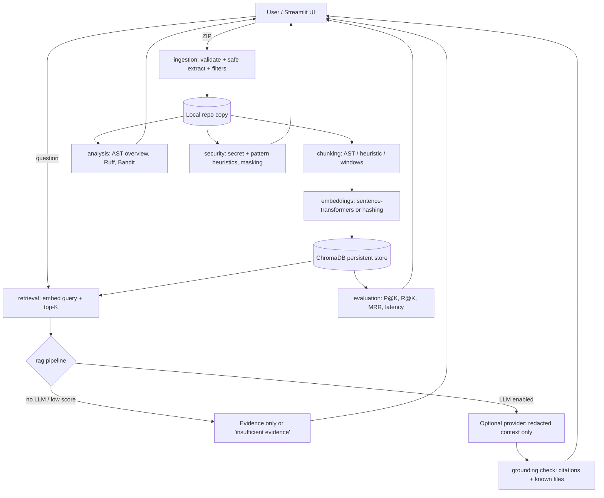

# 🧭 RepoPilot AI — AI-Powered Codebase Intelligence & Debugging Assistant

Upload a ZIP of a repository, explore its architecture, search the code semantically, ask questions with
retrieval-augmented generation (RAG), review static-analysis findings, and **measure** how good the retrieval is.

> **Honesty note.** Retrieval metrics in this project are *automated proxy metrics* computed against a small,
> author-labelled dataset. They are not human-verified answer quality, and RepoPilot AI does not claim to be
> hallucination-free or to perform a comprehensive security audit.

## Problem statement

Understanding an unfamiliar codebase is slow: you grep for keywords, guess at structure, and still miss where
authentication, routes, or database settings live. RepoPilot AI indexes a repository locally, lets you search by
*meaning*, and (optionally) uses an LLM to answer questions **only from retrieved code**, citing file paths and line ranges.

## Features

| Area | What it does |
|---|---|
| Upload & validation | ZIP size/file-count/extracted-size limits, path-traversal and symlink rejection, binary/`.git`/`node_modules`/build/venv filtering, secret files (`.env`, keys) never indexed. Code is **never executed**. |
| Repository overview | ASCII tree, languages & line counts, extensions, dependencies (requirements.txt, package.json, pyproject.toml, pom.xml), config files, folder purposes (labelled *estimates*), Python AST summary and HTTP routes, syntax-error reporting. |
| Indexing | AST-aware chunking for Python, heuristic boundaries for JS/TS/Java/Markdown, overlapping line windows otherwise. Every chunk keeps file path + 1-based line range. Local embeddings, persisted in ChromaDB. Index / re-index / delete workflow. |
| Semantic search | Top-K chunks with file, line range, language filter and cosine-similarity score (a ranking signal, **not** a probability). |
| RAG chat | Answers only from retrieved context with `[n]` citations; says *insufficient evidence* when retrieval is weak; works without an API key in **retrieval-only mode** (evidence is shown and labelled as not a generated answer). Handles missing index, empty/oversized input, provider errors, timeouts. |
| Static analysis | Ruff + Bandit (when installed) and built-in heuristic secret/risky-pattern rules. Secrets are masked in UI, exports, prompts and logs. Scanner output, heuristics and AI suggestions are shown in separate tabs. |
| Evaluation | Precision@K, Recall@K, MRR, citation-file correctness, keyword-coverage (deterministic evidence proxy), latency, failures, abstention on unanswerable questions. Charts + CSV/JSON export. Runs with no API key. |

## Architecture



### Major AI concepts used

* **Embeddings** map text to vectors so that similar meaning ⇒ nearby vectors. `all-MiniLM-L6-v2` (default) runs locally.
* **Vector search** (ChromaDB, cosine space) retrieves the chunks nearest to the query vector.
* **Code-aware chunking** keeps functions/classes intact so retrieved snippets are coherent and citable by line range.
* **RAG** = retrieve first, then generate from that context. Constraining the prompt to the retrieved snippets, requiring
  `[n]` citations and allowing "insufficient evidence" reduces (not eliminates) hallucination.
* **Evaluation**: Precision@K (how many retrieved chunks are relevant), Recall@K (how many relevant files were found),
  MRR (how early the first relevant result appears). Generation quality needs human review; automated checks only catch obvious ungrounded references.

### Design decisions

* **Local-first**: no code leaves your machine unless you explicitly enable an LLM provider.
* **Two embedding backends**: `sentence-transformers` (semantic) and `hashing` (offline lexical baseline for tests/demos with no model download). The hashing backend is *not* a neural model and is labelled as such everywhere.
* **Provider-agnostic LLM client** using only the standard library (`urllib`): OpenAI-compatible endpoints (incl. local Ollama) and Anthropic Messages API. No model name is hardcoded — you choose it.
* **Heuristics are labelled**: folder purposes, frameworks and secret/pattern findings are estimates.
* **Defence in depth on uploads**: validation before extraction, resolved-path containment check, isolated Ruff mode (ignores repo config).

## Project structure

```
repopilot-ai/
├── app.py                  # Streamlit entry point + navigation
├── config.py               # Settings from environment / .env
├── requirements.txt  .env.example  .gitignore  Dockerfile  docker-compose.yml  pytest.ini
├── src/
│   ├── ingestion/          # filters.py, zip_loader.py (safe extraction)
│   ├── parsing/            # python_ast.py
│   ├── chunking/           # chunker.py
│   ├── embeddings/         # embedder.py (sentence-transformers | hashing)
│   ├── retrieval/          # store.py (ChromaDB), indexer.py, search.py
│   ├── rag/                # pipeline.py, llm.py, grounding.py, suggestions.py
│   ├── analysis/           # repo_summary.py, static_tools.py, dashboard.py
│   ├── security/           # secrets.py (heuristics, masking, log redaction)
│   ├── evaluation/         # metrics.py, runner.py
│   └── ui/                 # theme.py, state.py, pages_repo.py, pages_ai.py
├── data/
│   ├── sample_repo/        # "ShelfLife" demo repository (original)
│   └── evaluation/         # questions.json (labelled evaluation set)
├── tests/                  # pytest suite
└── scripts/                # run_evaluation.py, reset_data.py
```

## Setup (Windows PowerShell)

Requires Python 3.11+ (3.12 also works).

```powershell
python -m venv .venv
.venv\Scripts\Activate.ps1
python -m pip install --upgrade pip
python -m pip install -r requirements.txt
Copy-Item .env.example .env
streamlit run app.py
```

If activation is blocked: `Set-ExecutionPolicy -Scope Process -ExecutionPolicy Bypass` and activate again.

**First run:** the default embedding model (~90 MB) is downloaded from the Hugging Face Hub the first time you index.
For a fully offline demo: `$env:EMBEDDING_BACKEND="hashing"` before launching (or pick it in **Settings**).

Quick demo: open the app → **Home → Load bundled sample repository** → **Upload → Index** → try **Semantic search** and **Evaluation**.

macOS/Linux: `python3 -m venv .venv && source .venv/bin/activate`, then the same pip/streamlit commands.

### Docker (optional)

```powershell
docker compose up --build   # then open http://localhost:8501
```

## Optional LLM configuration

Edit `.env` (see `.env.example`):

```ini
LLM_ENABLED=true
LLM_PROVIDER=openai          # or anthropic
LLM_MODEL=<model name from your provider>
OPENAI_API_KEY=...           # or ANTHROPIC_API_KEY
# Local OpenAI-compatible server (no key needed):
# LLM_BASE_URL=http://localhost:11434/v1
```

Without these the app starts and everything except natural-language answer generation works. With an external
provider, retrieved snippets (secret-like values redacted) are sent to that provider — only enable it for code you may share.
`https` is required for non-localhost endpoints.

## Tests and evaluation

```powershell
python -m pytest                              # full suite (offline; uses the hashing embedder)
python scripts/run_evaluation.py              # retrieval evaluation, no API key needed
python scripts/run_evaluation.py --backend hashing --k 5      # fully offline
python scripts/run_evaluation.py --with-llm   # also generate answers (needs an enabled provider)
python scripts/reset_data.py --yes            # delete all local data
```

Reports are written to `.repopilot_data/reports/` as `.json` and `.csv` (the CSV has an empty `human_rating` column for manual review).
Scores depend on the embedding backend and K; run the command to get your own numbers rather than trusting any figure quoted elsewhere.

## Security limitations

* Heuristic secret/pattern detection produces **false positives and false negatives**; it is not a security audit.
* Ruff/Bandit cover Python only; other languages receive only the heuristic rules.
* ZIP validation blocks traversal, absolute paths, symlinks and zip bombs by size, but you should still treat uploads as untrusted data.
* Text sent to an LLM can still contain sensitive business logic even after secret redaction.
* Prompt injection inside repository code is mitigated by prompt instructions only; treat generated answers as unverified and check the cited lines.
* The similarity threshold (`MIN_SCORE`, default 0.05) is untuned; a threshold alone does not reliably detect unanswerable questions (the evaluation reports this).

## Example screenshots

Screenshots are not bundled. After running the app, capture these and save them in `docs/screenshots/`:
Home, Overview, Semantic search, Chat (retrieval-only and generated), Static analysis, Evaluation dashboard.

## Troubleshooting

| Problem | Fix |
|---|---|
| `Could not load embedding model` | First run needs internet. Or set `EMBEDDING_BACKEND=hashing`. |
| Chat says *no model provider enabled* | Expected without `.env` LLM settings; retrieval evidence is still shown. |
| `Index was built with X but the active embedder is Y` | Re-index after changing backend or model. |
| Ruff/Bandit "not installed" | `python -m pip install ruff bandit` |
| Activation script blocked | `Set-ExecutionPolicy -Scope Process -ExecutionPolicy Bypass` |
| Chroma errors after upgrading | Run `python scripts/reset_data.py --yes` and re-index. |
| Upload rejected | Check the limits on the Upload page (adjust in `.env`). |

## Future improvements

Hybrid (BM25 + dense) retrieval and re-ranking; tree-sitter chunking for non-Python languages; call-graph/dependency visualisation;
streaming answers; larger human-reviewed evaluation sets; calibrated abstention; multi-repo questions; GitHub URL import.

## Verification status

See `CHECKLIST.md` for what was executed, what was not, and known gaps.
